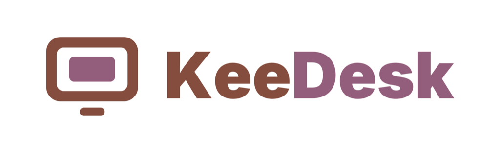
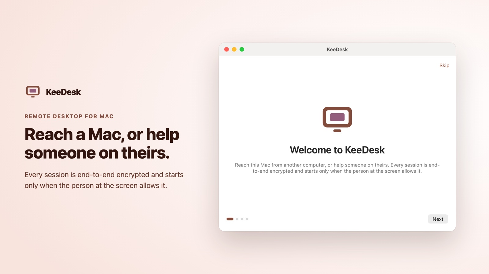
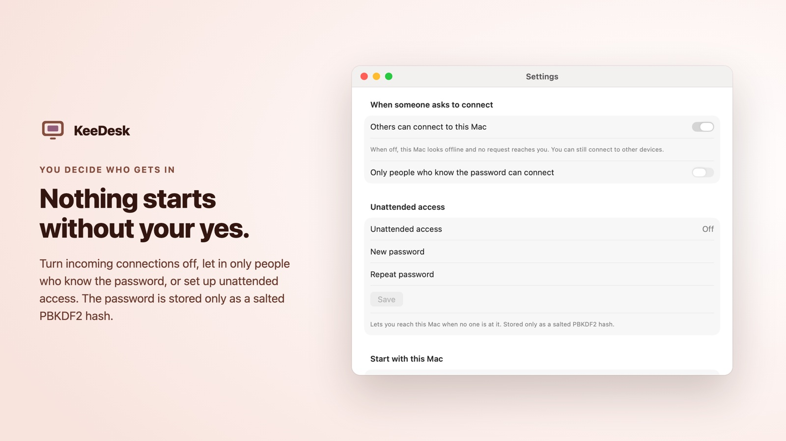

  <picture>
    <source media="(prefers-color-scheme: dark)" srcset="docs/images/keedesk-logo-dark.png">
    
  </picture>

<h1 align="center">KeeDesk — secure remote desktop for Mac and Windows</h1>

  Reach your computer from another one, or help someone on theirs. End-to-end encrypted, and nothing starts until the person at the screen says yes.

  
  
  
  

---

> **KeeDesk for Mac is available.** Download the latest version from [Releases](https://github.com/egerobot/keedesk-releases/releases/latest) or from [keedesk.com](https://keedesk.com/en/download.html). KeeDesk is built natively for each system — Swift on the Mac, WinUI on Windows — and every version speaks the same encrypted protocol, so a Mac and a Windows PC connect to each other. Select **Watch → Custom → Releases** above to be notified of new versions.

This repository is the **official download channel for KeeDesk on GitHub**. It holds release files only — no source code. Every release carries a Developer ID signed, Apple-notarized installer and a `SHA256SUMS` file.

## Availability

| Platform | Status |
|---|---|
| **macOS 14 or later** (Apple silicon and Intel) | Available — [download](https://github.com/egerobot/keedesk-releases/releases/latest/download/KeeDesk.dmg) |
| **Windows 10 and 11** (native WinUI app, x64 and ARM64) | Coming to the Microsoft Store |
| **Linux** | Planned |
| **iOS and Android** | Planned, after the desktop apps; development has not started yet |

## What KeeDesk does

### Connect with a 9-digit ID

Every computer gets a **KeeDesk ID** derived from its own key pair, so no server can invent or reassign it. Type the other side's ID and press Connect. KeeDesk also finds other KeeDesk devices **on the same network**, keeps your **recent sessions**, and lets you rename them.

### Nothing starts without your yes

- An **accept window** shows who is asking; you choose what they may do and can change it during the session.
- **Turn off incoming connections** in one switch, or let in **only people who know the password**.
- **Unattended access** for your own computers, with **two-factor authentication (TOTP)**, an **allow list** of IDs and **permission profiles** (view only, full access, unattended or your own).
- A **one-time invitation code** that works once and expires in two hours.
- A **coloured frame** around your screen while someone is connected, an optional **screen lock when the session ends**, and a **connection history**.

### Security you can check

- **End-to-end encryption**: X25519 key exchange, Ed25519-signed handshake, ChaCha20-Poly1305 with separate keys per direction.
- A **security code** (fingerprint) both sides can compare; if a known device's key changes, KeeDesk stops and tells you.
- Passwords are stored only as a **salted PBKDF2-SHA256 hash** (310,000 rounds), compared in constant time, with growing wait times after wrong attempts and a **request-flood guard**.
- When a session is recorded, the other side is **always told**.

### Plain-language permissions

On the Mac, KeeDesk shows the three permissions macOS asks for — Screen Recording, Accessibility and Full Disk Access — says what each one is for, and lets you check or reset them in one place.

### Fast, sharp picture

- Hardware **HEVC or H.264** encoding and decoding; on the Mac through ScreenCaptureKit capture (KeeDesk's own windows left out) and VideoToolbox.
- Adaptive quality (speed · balanced · best), and per-session limits for **resolution, frame rate and bit rate**.
- Multiple monitors, a separate **remote cursor** channel, original or fit-to-window view.

### Everything a session needs

- **Mouse and keyboard** control with Unicode typing and shortcut forwarding (⌘-Tab and others); stuck modifier keys are cleared when a session ends.
- **Clipboard sync** for text and images, **file transfer** with a two-pane file manager, **drag a file onto the remote screen** to send it or drag a remote file to Finder to receive it.
- **Chat**, **system sound**, **two-way voice** with microphone choice and test.
- **Screenshots** on the viewing side, **session recording**, **whiteboard**, **privacy mode** (blank the remote screen), **block local input**.
- **Remote restart** with automatic reconnect, **system information**, **TCP tunnel**, **Wake-on-LAN**.
- A **support queue**: people ask for help with your ID and you take them one by one.
- **Connect from a link** — a `keedesk://` link opens a question, never a session.
- **41 interface languages**, switched in Settings without restarting; right-to-left languages mirror the window.

## Roadmap

- Windows on the Microsoft Store.
- Linux; then iOS, iPadOS and Android.
- Business: your own rendezvous server, mass deployment, single sign-on and branding.

## Security reports

See [SECURITY.md](SECURITY.md).

---

KeeDesk is a product of **EGEROBOT** (EGEROBOT OTOMASYON MÜHENDİSLİK PROJE DANIŞMANLIK SAN. VE TİC. LTD. ŞTİ.), İzmir, Türkiye. KeeDesk is proprietary software; see [LICENSE](LICENSE). 
Keywords: remote desktop, remote desktop for Mac, remote desktop for Windows, Mac to Windows remote desktop, macOS remote access, Windows remote access, Linux remote desktop, remote support, remote control, screen sharing, unattended access, end-to-end encrypted remote desktop, remote desktop app, uzak masaüstü, uzaktan bağlantı, uzaktan destek, ekran paylaşımı, KeeDesk.
