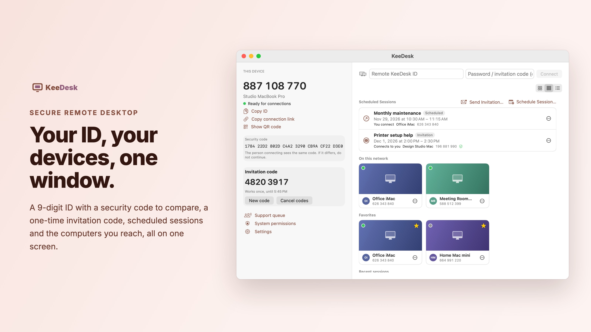
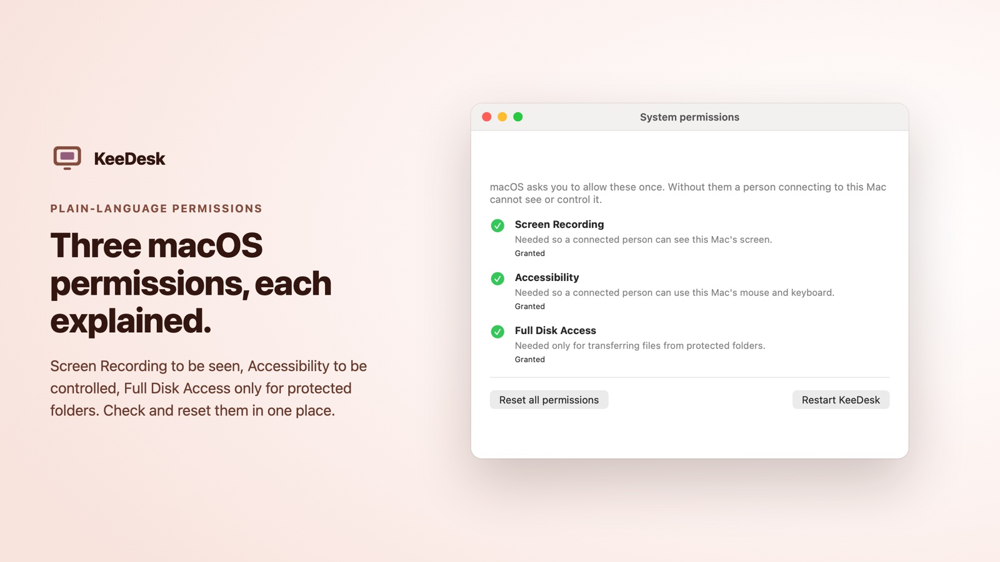
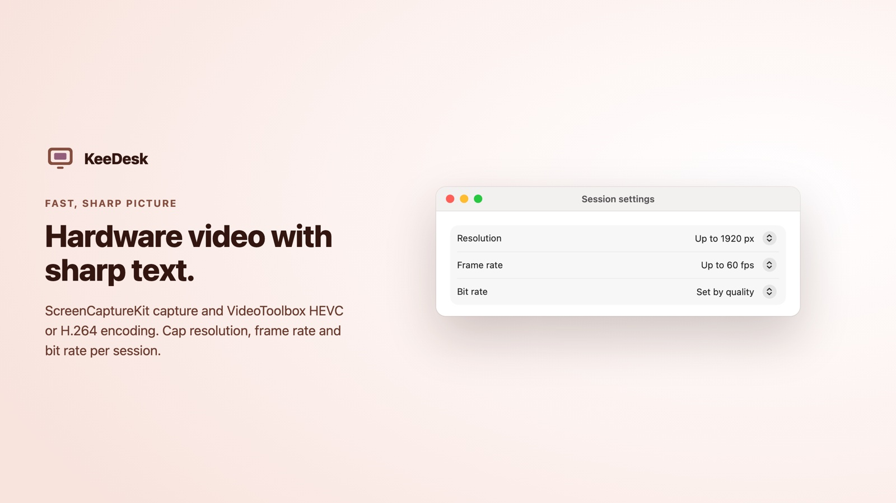
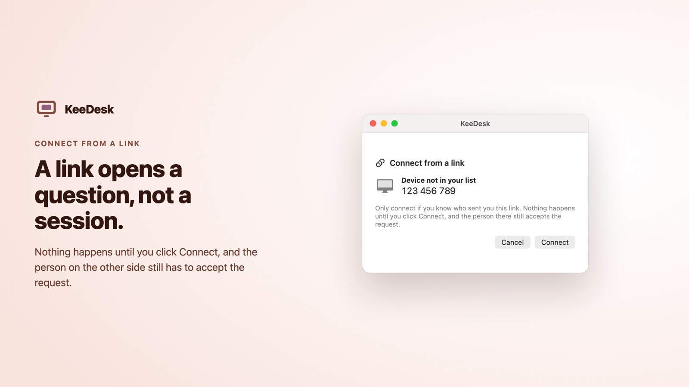

<p align="center">
  <picture>
    <source media="(prefers-color-scheme: dark)" srcset="docs/images/keedesk-logo-dark.png">
    
  </picture>
</p>

<h1 align="center">KeeDesk — secure remote desktop for Mac and Windows</h1>

<p align="center">
  End-to-end encrypted remote desktop: remote access to your own computers and remote support for someone else's. Nothing starts until the person at the screen says yes.
</p>

<p align="center">
  
  <a href="https://apps.microsoft.com/detail/9p2gw8zsnhw7"></a>
  
  <a href="README.tr.md"></a>
</p>

---

> **KeeDesk for Mac is available.** Download the latest version from [Releases](https://github.com/egerobot/keedesk-releases/releases/latest) or from [keedesk.com](https://keedesk.com/en/download.html). Select **Watch → Custom → Releases** above to be notified of new versions.

This repository is the **official download channel for KeeDesk on GitHub**. It holds release files only — no source code. Every macOS release carries a Developer ID signed, Apple-notarized disk image and a zip archive of the app, and every release carries a `SHA256SUMS` file. The Windows app is distributed through the Microsoft Store.



## Download KeeDesk for Mac

- **[Download KeeDesk.dmg](https://github.com/egerobot/keedesk-releases/releases/latest/download/KeeDesk.dmg)** — always the latest version.
- **macOS 14 Sonoma or later**, Apple silicon and Intel (one universal app).
- Signed with Developer ID and notarized by Apple.
- After installing, KeeDesk checks for updates at launch; you can choose the stable or the beta channel.
- No account is needed to give or get help. You sign in with an e-mail code only when you want a plan.

## Availability

| Platform | Status |
|---|---|
| **macOS 14 or later** (Apple silicon and Intel) | Available — [download](https://github.com/egerobot/keedesk-releases/releases/latest/download/KeeDesk.dmg) |
| **Windows 10 (1809) and 11** (native WinUI app, x64 and ARM64) | Available — [Microsoft Store](https://apps.microsoft.com/detail/9p2gw8zsnhw7) |
| **Linux** | Planned |
| **iOS and iPadOS** | In development; coming to the App Store |
| **Android** | Planned |

KeeDesk is built natively for each system — Swift on the Mac, C# and WinUI on Windows — and every version speaks the same encrypted protocol.

## Connect with a 9-digit ID

Every computer gets a **KeeDesk ID** derived from its own key pair, so no server can invent or reassign it. Type the other side's ID and press Connect. KeeDesk also finds other KeeDesk devices **on the same network**, keeps your **recent sessions** and **favorites**, and lets you rename them. A connection **link or QR code** carries the ID and the full security code, so even the first connection is verified.

KeeDesk first tries a direct connection between the two computers. When that is not possible, the session goes through our relay, which forwards sealed packets it cannot open.

## Remote support — help someone on their computer


- An **accept window** shows who is asking; the person at the screen chooses what you may do and can change it during the session.
- A **one-time invitation code** for a single help session: it works once and, unless you set a time, expires in two hours.
- A **support queue**: people ask for help with your ID and you take them one by one. Joining the queue is not consent — the accept window still appears.
- **Session recording** to a video file; the other side is **always told** when recording starts.
- **Whiteboard** (draw on the remote screen), **system information**, **remote restart** with automatic reconnect.

## Remote access to your own Mac — unattended access

- **Unattended access** with a password of its own, **two-factor authentication (TOTP)**, an **access list** of allowed IDs and **permission profiles** (default, screen only, full access, unattended or your own).
- On macOS, your Mac can be **reached at the sign-in screen and after a restart** (the KeeDesk helper needs administrator approval once).
- **Remembered devices** for computers you trust, revocable at once.
- **Wake-on-LAN** for a sleeping computer and a **TCP tunnel** to a port on the remote network.
- **Turn off incoming connections** in one switch (the Mac then looks offline), or let in **only people who know the password**.

## End-to-end encrypted by design

- **End-to-end encryption**: X25519 key exchange, Ed25519-signed handshake, ChaCha20-Poly1305 with a separate key for each direction. Keys live only on the two devices.
- A **security code** (fingerprint) both sides can compare; if a known device's key changes, KeeDesk stops and tells you.
- **The unattended-access password is never sent.** The connecting side proves it by answering a challenge bound to that one connection. The Mac being reached keeps only a salted **PBKDF2-SHA256** value (310,000 rounds) in its device-only Keychain item.
- Wrong guesses are braked: after five failures each device waits, starting at 30 seconds and doubling up to 15 minutes. A **request-flood guard** limits how many requests can ring at once.
- A **coloured frame** around your screen while someone is connected, an optional **screen lock when the session ends**, and a **connection history** of who connected, how they were let in, what they did and which files moved.

## Plain-language permissions



On the Mac, KeeDesk shows the three permissions macOS asks for — Screen Recording, Accessibility and Full Disk Access — says what each one is for, and lets you check, request or fix them in one place.

## Fast, sharp picture on the Mac



- Hardware **HEVC or H.264** encoding and decoding through **ScreenCaptureKit** capture (KeeDesk's frame, privacy curtain and camera window left out) and **VideoToolbox**.
- Still text refined to lossless, full-colour tiles.
- Quality presets (speed · balanced · best), and per-session limits for **resolution, frame rate and bit rate**.
- Multiple monitors, a separate **remote cursor** channel, original or fit-to-window view.

## Everything a session needs

- **Remote control** with mouse and keyboard, Unicode typing and shortcut forwarding (⌘-Tab stays on your Mac); stuck modifier keys are cleared when a session ends.
- **File transfer** with a two-pane file manager: **drag a file onto the remote screen** to send it, or drag a remote file to Finder to receive it.
- **Clipboard sync** for text and images.
- **Chat**, **system sound**, **two-way voice** with microphone choice and test, and **camera** on both sides, off until you switch it on.
- **Screenshots** on the viewing side, **privacy mode** (blank the remote screen), **block local input**.
- **Connect from a link** — a `keedesk://` link opens a question, never a session.
- **41 interface languages**, changed in Settings: windows switch at once, the menu bar at the next launch; right-to-left languages mirror the window.



## Plans

KeeDesk is **free for personal use**: sessions on the same network are unlimited; sessions over the internet last up to 30 minutes each and 3 hours a day. Paid plans remove these limits and allow commercial use. If either computer in a session is signed in to a paid account, the whole session runs on that plan. See [keedesk.com/en/subscription.html](https://keedesk.com/en/subscription.html).

## Verify your download

Every release has a `SHA256SUMS` file.

```bash
shasum -a 256 -c SHA256SUMS --ignore-missing         # expect: KeeDesk.dmg: OK
xcrun stapler validate KeeDesk.dmg                    # expect: The validate action worked!
codesign -dv --verbose=2 /Applications/KeeDesk.app    # after installing
```

The app is signed by **Developer ID Application: EGEROBOT OTOMASYON MUHENDISLIK PROJE DANISMANLIK SANAYI VE TICARET LIMITED SIRKETI (9S8KV52JV4)** and notarized by Apple.

## Frequently asked questions

**How do I remote desktop from one Mac to another?**
Install KeeDesk on both Macs. On the Mac you want to reach, read its 9-digit KeeDesk ID; on the other Mac, type that ID and press Connect. The person at the first Mac accepts the request, and both screens show the same security code. On the same network KeeDesk also lists the other Mac for you.

**Can I reach my Mac when no one is at it?**
Yes, with unattended access, which you switch on yourself. It is protected by its own password and, if you want, a two-factor code and an access list of allowed IDs. On macOS the Mac can also be reached at the sign-in screen and after a restart.

**Is KeeDesk free?**
Yes, for personal use. Same-network sessions are unlimited; internet sessions last up to 30 minutes each and 3 hours a day.

**Is remote desktop safe? How can I tell if someone is connected to my computer?**
By default, a KeeDesk session starts only after you accept it in the accept window; unattended access is a separate setting you switch on yourself. While someone is connected, a coloured frame surrounds your screen; every connection is written to the connection history; and if the session is recorded you are told.

**Is the connection encrypted? Can the relay see my screen?**
Every session is encrypted end to end between the two computers. When it goes through our relay, the relay only forwards sealed packets and holds no key to open them.

**How do I copy files to the remote computer?**
Open the two-pane file manager, or drop a file onto the remote screen. To take a file, drag it from the remote side into Finder.

**Is there a Windows version?**
Yes. KeeDesk for Windows 10 (1809) and 11 is on the [Microsoft Store](https://apps.microsoft.com/detail/9p2gw8zsnhw7). It is a native WinUI app and speaks the same encrypted protocol as the Mac app.

**Which macOS permissions does KeeDesk need and why?**
Screen Recording (so the other side can see the screen), Accessibility (so they can use the mouse and keyboard) and Full Disk Access. KeeDesk explains each one and opens the right System Settings page.

**Is there a Linux, iPhone, iPad or Android version?**
iOS and iPadOS are in development; Linux and Android are planned. All of them will use the same protocol.

## Roadmap

- iOS and iPadOS on the App Store.
- Linux; then Android.
- Business: your own rendezvous server, mass deployment, single sign-on and branding.

## Security reports

See [SECURITY.md](SECURITY.md).

---

<sub>KeeDesk is a product of **EGEROBOT** (EGEROBOT OTOMASYON MÜHENDİSLİK PROJE DANIŞMANLIK SAN. VE TİC. LTD. ŞTİ.), İzmir, Türkiye. KeeDesk is proprietary software; see [LICENSE](LICENSE).</sub>
