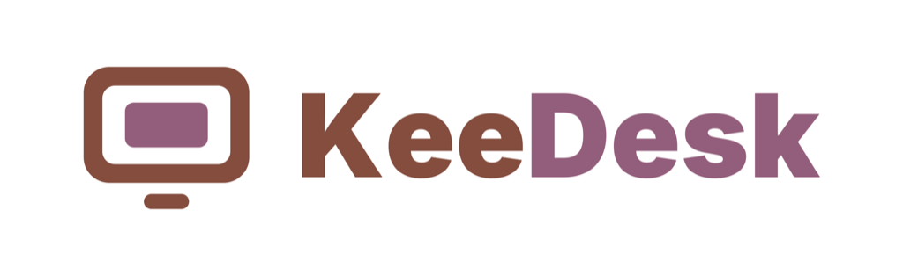
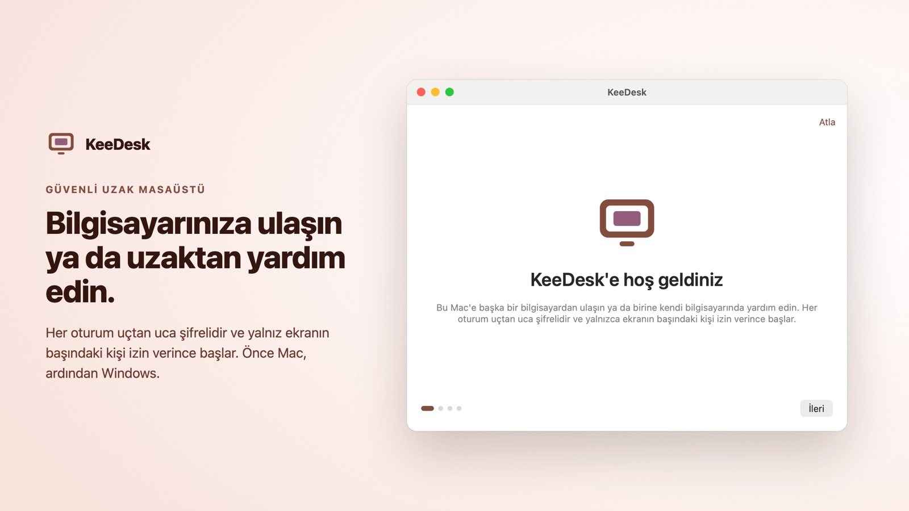
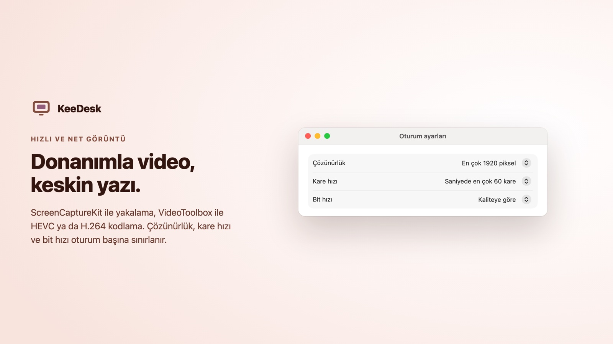

<p align="center">
  <picture>
    <source media="(prefers-color-scheme: dark)" srcset="docs/images/keedesk-logo-dark.png">
    
  </picture>
</p>

<h1 align="center">KeeDesk — Mac ve Windows için güvenli uzak masaüstü programı</h1>

<p align="center">
  Uçtan uca şifreli uzak masaüstü: kendi bilgisayarınıza uzaktan erişin ya da başkasına uzaktan destek verin. Ekranın başındaki kişi evet demeden hiçbir şey başlamaz.
</p>

<p align="center">
  
  <a href="https://apps.microsoft.com/detail/9p2gw8zsnhw7"></a>
  
  <a href="README.md"></a>
</p>

---

> **Mac için KeeDesk indirilebilir.** En son sürümü [Releases](https://github.com/egerobot/keedesk-releases/releases/latest) sayfasından ya da [keedesk.com](https://keedesk.com/tr/download.html) adresinden indirin. Yeni sürümlerden haber almak için yukarıdan **Watch → Custom → Releases** seçin.

Bu depo **KeeDesk'in GitHub'daki resmî indirme kanalıdır**. Yalnız sürüm dosyaları bulunur, kaynak kod yoktur. Her macOS sürümünde Developer ID ile imzalı, Apple noter onaylı disk görüntüsü ve uygulamanın zip arşivi, her sürümde de `SHA256SUMS` dosyası bulunur. Windows uygulaması Microsoft Store üzerinden dağıtılır.



## Mac için KeeDesk'i indirin

- **[KeeDesk.dmg'yi indir](https://github.com/egerobot/keedesk-releases/releases/latest/download/KeeDesk.dmg)** — her zaman en son sürüm.
- **macOS 14 Sonoma ya da sonrası**, Apple çipli ve Intel (tek evrensel uygulama).
- Developer ID ile imzalı, Apple noter onaylı.
- Kurulumdan sonra KeeDesk açılışta güncellemeyi kendisi denetler; kararlı ya da beta kanalını seçebilirsiniz.
- Yardım vermek ya da almak için hesap gerekmez. E-posta koduyla giriş yalnız bir plan istediğinizde gerekir.

## Durum

| Platform | Durum |
|---|---|
| **macOS 14 ve sonrası** (Apple çipli ve Intel) | İndirilebilir — [indir](https://github.com/egerobot/keedesk-releases/releases/latest/download/KeeDesk.dmg) |
| **Windows 10 (1809) ve 11** (yerel WinUI uygulaması, x64 ve ARM64) | İndirilebilir — [Microsoft Store](https://apps.microsoft.com/detail/9p2gw8zsnhw7) |
| **Linux** | Planlandı |
| **iOS ve iPadOS** | Geliştiriliyor; App Store'a gelecek |
| **Android** | Planlandı |

KeeDesk her sistem için yerel olarak yazılır — Mac'te Swift, Windows'ta C# ve WinUI ile — ve hepsi aynı şifreli protokolü konuşur.

## 9 haneli ID ile uzaktan bilgisayara bağlanma

Her bilgisayar kendi anahtar çiftinden türeyen bir **KeeDesk ID** alır; hiçbir sunucu bu numarayı uyduramaz ya da başkasına veremez. Karşı tarafın ID'sini yazın ve Bağlan'a basın. KeeDesk **aynı ağdaki** öteki KeeDesk cihazlarını da bulur, **son oturumlarınızı** ve **favorilerinizi** tutar, onları yeniden adlandırmanıza izin verir. **Bağlantı adresi ya da karekod** ID'yi ve güvenlik kodunun tamamını taşır; böylece ilk bağlantı bile doğrulanır.

KeeDesk önce iki bilgisayar arasında doğrudan bağlantı dener. Bu mümkün değilse oturum aktarma sunucumuzdan geçer; sunucu açamadığı mühürlü paketleri yalnız iletir.

## Uzaktan destek — başkasının bilgisayarında yardım edin


- **Kabul penceresi** kimin istediğini gösterir; ekranın başındaki kişi neler yapabileceğinizi seçer ve oturum sırasında değiştirebilir.
- Tek seferlik yardım için **tek kullanımlık davet kodu**: bir kez çalışır ve süre belirtmezseniz iki saatte sona erer.
- **Destek kuyruğu**: kişiler ID'nizle yardım ister, siz sırayla alırsınız. Kuyruğa katılmak onay değildir; kabul penceresi yine çıkar.
- Video dosyasına **oturum kaydı**; kayıt başladığında karşı tarafa **her zaman bildirilir**.
- **Beyaz tahta** (uzak ekrana çizim), **sistem bilgisi**, otomatik yeniden bağlanmalı **uzaktan yeniden başlatma**.

## Kendi Mac'inize uzaktan erişim — gözetimsiz erişim

- Kendine ait şifresi, **iki aşamalı doğrulaması (TOTP)**, izinli ID'lerden oluşan **erişim listesi** ve **izin profilleri** (varsayılan, yalnız ekran, tam erişim, gözetimsiz ya da size özel) olan **gözetimsiz erişim**.
- macOS'ta Mac'inize **giriş ekranında ve yeniden başlatmadan sonra** da ulaşılabilir (KeeDesk yardımcısı bir kez yönetici onayı ister).
- Güvendiğiniz bilgisayarlar için **hatırlanan cihazlar**; bu izin istediğiniz an geri alınabilir.
- Uyuyan bilgisayar için **Wake-on-LAN**, uzak ağdaki bir porta **TCP tüneli**.
- **Gelen bağlantıları** tek düğmeyle kapatın (Mac çevrimdışı görünür) ya da **yalnız şifreyi bilenleri** içeri alın.

## Uçtan uca şifreli: güvenli uzaktan bağlantı nasıl olur

- **Uçtan uca şifreleme**: X25519 anahtar değişimi, Ed25519 imzalı el sıkışma, yön başına ayrı anahtarla ChaCha20-Poly1305. Anahtarlar yalnız iki cihazda durur.
- İki tarafın karşılaştırabildiği **güvenlik kodu** (parmak izi); bilinen bir cihazın anahtarı değişirse KeeDesk durur ve size söyler.
- **Gözetimsiz erişim şifresi hiç gönderilmez.** Bağlanan taraf şifreyi, yalnız o bağlantıya bağlı bir soru-yanıtla kanıtlar. Ulaşılan Mac, cihaza bağlı Anahtar Zinciri kaydında yalnız tuzlu bir **PBKDF2-SHA256** değeri (310.000 tur) tutar.
- Yanlış denemeler frenlenir: beş hatadan sonra o cihaz bekler; bekleme 30 saniyeden başlar, her seferinde iki katına çıkar, en çok 15 dakikadır. **İstek seli koruması** aynı anda çalabilecek istek sayısını sınırlar.
- Biri bağlıyken ekranınızın çevresinde **renkli çerçeve**, isteğe bağlı **oturum sonunda ekran kilidi** ve kimin bağlandığını, nasıl içeri alındığını, ne yaptığını ve hangi dosyaların taşındığını gösteren **bağlantı geçmişi**.

## Açık dille izinler


Mac'te KeeDesk, macOS'un istediği üç izni — Ekran Kaydı, Erişilebilirlik ve Tam Disk Erişimi — gösterir, her birinin ne için gerektiğini söyler ve hepsini tek yerden denetleyip istemenizi ya da düzeltmenizi sağlar.

## Mac'te hızlı ve net görüntü



- Donanımla **HEVC ya da H.264** kodlama ve çözme; KeeDesk'in çerçevesini, gizlilik perdesini ve kamera penceresini dışarıda bırakan **ScreenCaptureKit** yakalama ve **VideoToolbox** ile.
- Duran metin kayıpsız, tam renkli karolara dönüştürülür.
- Kalite seçimi (hız · denge · en iyi) ve oturum başına **çözünürlük, kare hızı ve bit hızı** sınırı.
- Çoklu monitör, ayrı **uzak imleç** kanalı, orijinal ya da pencereye sığdır görünüm.

## Bir oturumun ihtiyacı olan her şey

- Unicode yazma ve kısayol iletimiyle (⌘-Tab sizin Mac'inizde kalır) **fare ve klavyeyle uzaktan kontrol**; oturum bitince takılı kalan değiştirici tuşlar temizlenir.
- İki panelli dosya yöneticisiyle **dosya aktarımı**: göndermek için **dosyayı uzak ekranın üstüne bırakın**, almak için uzak dosyayı Finder'a sürükleyin.
- Metin ve görsel için **pano eşitleme**.
- **Sohbet**, **sistem sesi**, mikrofon seçimi ve testiyle **iki yönlü konuşma** ve iki tarafta da siz açana kadar kapalı duran **kamera**.
- İzleyen tarafta **ekran görüntüsü**, **gizlilik kipi** (uzak ekranı karart), **yerel girdiyi kilitle**.
- **Bağlantıyla bağlanma** — `keedesk://` bağlantısı oturum değil, soru açar.
- **41 arayüz dili**; Ayarlar'dan değişir: pencereler anında, menü çubuğu bir sonraki açılışta değişir; sağdan sola yazılan dillerde pencere aynalanır.


## Planlar

KeeDesk **kişisel kullanımda ücretsiz** bir uzak masaüstü programıdır: aynı ağdaki oturumlar sınırsızdır; internet üzerinden oturumlar her biri en çok 30 dakika ve günde 3 saat sürer. Ücretli planlar bu sınırları kaldırır ve ticari kullanıma izin verir. Oturumdaki bilgisayarlardan biri ücretli bir hesaba bağlıysa oturumun tamamı o planla çalışır. Bkz. [keedesk.com/tr/subscription.html](https://keedesk.com/tr/subscription.html).

## İndirdiğiniz dosyayı doğrulayın

Her sürümde bir `SHA256SUMS` dosyası vardır.

```bash
shasum -a 256 -c SHA256SUMS --ignore-missing         # beklenen: KeeDesk.dmg: OK
xcrun stapler validate KeeDesk.dmg                    # beklenen: The validate action worked!
codesign -dv --verbose=2 /Applications/KeeDesk.app    # kurulumdan sonra
```

Uygulama **Developer ID Application: EGEROBOT OTOMASYON MUHENDISLIK PROJE DANISMANLIK SANAYI VE TICARET LIMITED SIRKETI (9S8KV52JV4)** ile imzalı ve Apple onaylıdır.

## Sık sorulan sorular

**Mac'ten Mac'e uzak masaüstü bağlantısı nasıl yapılır?**
KeeDesk'i iki Mac'e de kurun. Ulaşmak istediğiniz Mac'te 9 haneli KeeDesk ID'yi okuyun; öteki Mac'te bu ID'yi yazıp Bağlan'a basın. İlk Mac'in başındaki kişi isteği kabul eder ve iki ekranda da aynı güvenlik kodu görünür. Aynı ağdaysanız KeeDesk öteki Mac'i sizin için listeler.

**Başında kimse yokken kendi bilgisayarıma nasıl bağlanırım?**
Kendiniz açtığınız gözetimsiz erişimle. Kendine ait şifresi vardır; isterseniz iki aşamalı kod ve izinli ID'lerden oluşan erişim listesi de eklenir. macOS'ta Mac'e giriş ekranında ve yeniden başlatmadan sonra da ulaşılabilir.

**KeeDesk ücretsiz mi?**
Kişisel kullanımda evet. Aynı ağdaki oturumlar sınırsızdır; internet oturumları her biri en çok 30 dakika ve günde 3 saat sürer.

**Uzak masaüstü bağlantısı güvenli mi? Bilgisayarıma uzaktan bağlanıldığını nasıl anlarım?**
Varsayılan olarak KeeDesk oturumu ancak siz kabul penceresinde kabul ettikten sonra başlar; gözetimsiz erişim, kendinizin açtığı ayrı bir ayardır. Biri bağlıyken ekranınızın çevresinde renkli çerçeve durur, her bağlantı bağlantı geçmişine yazılır ve oturum kaydedilirse size bildirilir.

**Bağlantı şifreli mi? Aktarma sunucusu ekranımı görebilir mi?**
Her oturum iki bilgisayar arasında uçtan uca şifrelidir. Oturum aktarma sunucumuzdan geçerse sunucu yalnız mühürlü paketleri iletir; onları açacak anahtarı yoktur.

**Windows sürümü var mı?**
Evet. Windows 10 (1809) ve 11 için KeeDesk [Microsoft Store'da](https://apps.microsoft.com/detail/9p2gw8zsnhw7). Yerel bir WinUI uygulamasıdır ve Mac uygulamasıyla aynı şifreli protokolü konuşur.

**Mac'te ekran paylaşımına (Ekran Kaydı iznine) nasıl izin verilir?**
KeeDesk, Ekran Kaydı, Erişilebilirlik ve Tam Disk Erişimi izinlerini tek ekranda gösterir, her birinin ne işe yaradığını söyler ve Sistem Ayarları'nın doğru sayfasını açar. Orada KeeDesk'i açmanız yeterlidir.

**Linux, iPhone, iPad ya da Android sürümü var mı?**
iOS ve iPadOS geliştiriliyor; Linux ve Android planlandı. Hepsi aynı protokolü kullanacak.

## Yol haritası

- App Store'da iOS ve iPadOS.
- Linux; ardından Android.
- Kurumsal: kendi buluşma sunucunuz, toplu kurulum, tek oturum açma ve markalama.

## Güvenlik bildirimi

Bkz. [SECURITY.md](SECURITY.md).

---

<sub>KeeDesk, **EGEROBOT**'un (EGEROBOT OTOMASYON MÜHENDİSLİK PROJE DANIŞMANLIK SAN. VE TİC. LTD. ŞTİ.) ürünüdür, İzmir, Türkiye. KeeDesk kapalı kaynak, ticari bir yazılımdır; bkz. [LICENSE](LICENSE).</sub>
