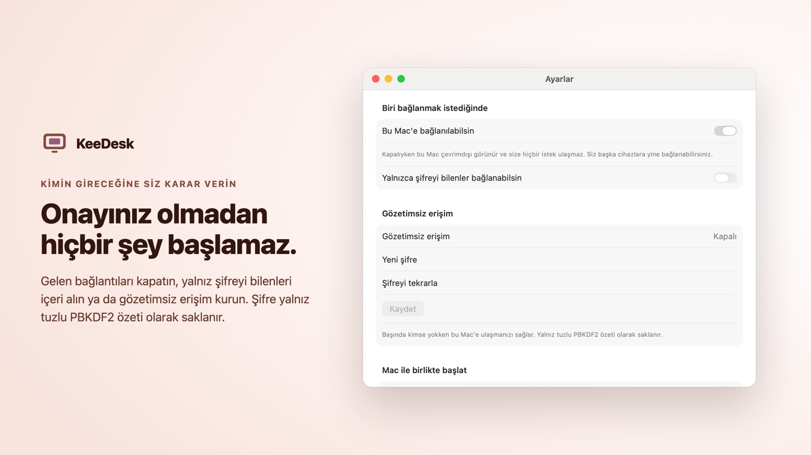
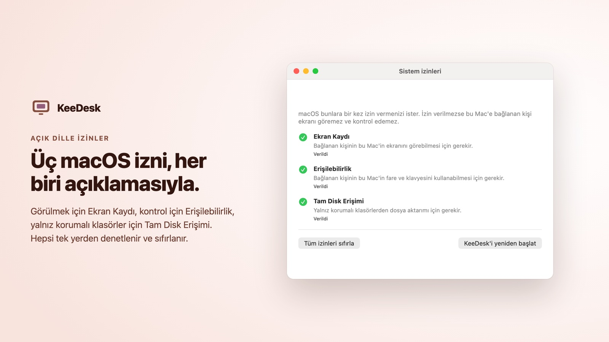
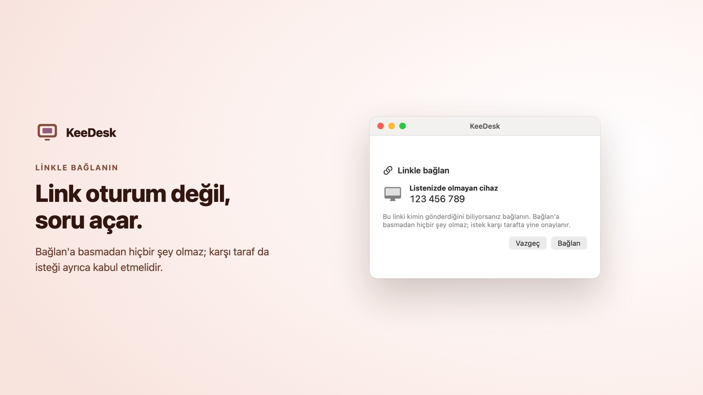

  <picture>
    <source media="(prefers-color-scheme: dark)" srcset="docs/images/keedesk-logo-dark.png">
    
  </picture>

<h1 align="center">KeeDesk — Mac ve Windows için güvenli uzak masaüstü</h1>

  Bilgisayarınıza başka bir bilgisayardan ulaşın ya da birine kendi ekranında yardım edin. Uçtan uca şifreli; ekranın başındaki kişi evet demeden hiçbir şey başlamaz.

  
  
  
  

---

> **Mac için KeeDesk indirilebilir.** En son sürümü [Releases](https://github.com/egerobot/keedesk-releases/releases/latest) sayfasından ya da [keedesk.com](https://keedesk.com/tr/download.html) adresinden indirin. KeeDesk her sistem için kendi diliyle yazılıyor — Mac'te Swift, Windows'ta WinUI — ve hepsi aynı şifreli protokolü konuşur; Mac ile Windows bilgisayar birbirine bağlanır. Yeni sürümlerden haber almak için yukarıdan **Watch → Custom → Releases** seçin.

Bu depo **KeeDesk'in GitHub'daki resmî indirme kanalıdır**. Yalnız sürüm dosyaları bulunur, kaynak kod yoktur. Her sürümde Developer ID ile imzalı, Apple onaylı (notarize) kurulum dosyası ve `SHA256SUMS` dosyası bulunur.

## Platformlar

| Platform | Durum |
|---|---|
| **macOS 14 ve sonrası** (Apple çipli ve Intel) | İndirilebilir — [indir](https://github.com/egerobot/keedesk-releases/releases/latest/download/KeeDesk.dmg) |
| **Windows 10 ve 11** (yerel WinUI uygulaması, x64 ve ARM64) | Yakında Microsoft Store'da |
| **Linux** | Planlandı |
| **iOS ve Android** | Planlandı, masaüstü uygulamalarından sonra; geliştirmesine henüz başlanmadı |

## KeeDesk neler yapar

### 9 haneli ID ile bağlanın

Her bilgisayar kendi anahtar çiftinden türeyen bir **KeeDesk ID** alır; hiçbir sunucu bu numarayı uyduramaz ya da başkasına veremez. Karşı tarafın ID'sini yazın ve Bağlan'a basın. KeeDesk **aynı ağdaki** öteki KeeDesk cihazlarını da bulur, **son oturumlarınızı** tutar ve onları yeniden adlandırmanıza izin verir.

### Onayınız olmadan hiçbir şey başlamaz

- **Kabul penceresi** kimin istediğini gösterir; neler yapabileceğini siz seçersiniz ve oturum sırasında değiştirebilirsiniz.
- **Gelen bağlantıları** tek düğmeyle kapatın ya da **yalnız şifreyi bilenleri** içeri alın.
- Kendi bilgisayarlarınız için **gözetimsiz erişim**; **iki aşamalı doğrulama (TOTP)**, ID **izin listesi** ve **izin profilleri** (yalnız ekran, tam erişim, gözetimsiz ya da size özel) ile.
- Bir kez çalışan ve iki saatte sona eren **tek kullanımlık davet kodu**.
- Biri bağlıyken ekranınızın çevresinde **renkli çerçeve**, isteğe bağlı **oturum sonunda ekran kilidi** ve **bağlantı geçmişi**.

### Denetlenebilir güvenlik

- **Uçtan uca şifreleme**: X25519 anahtar değişimi, Ed25519 imzalı el sıkışma, yön başına ayrı anahtarla ChaCha20-Poly1305.
- İki tarafın karşılaştırabildiği **güvenlik kodu** (parmak izi); bilinen bir cihazın anahtarı değişirse KeeDesk durur ve size söyler.
- Şifre yalnız **tuzlu PBKDF2-SHA256 özeti** (310.000 tur) olarak saklanır, sabit sürede karşılaştırılır; hatalı denemelerden sonra bekleme süresi artar ve **istek seli koruması** devrededir.
- Oturum kaydedildiğinde karşı tarafa **her zaman bildirilir**.

### Açık dille izinler

Mac'te KeeDesk, macOS'un istediği üç izni — Ekran Kaydı, Erişilebilirlik ve Tam Disk Erişimi — gösterir, her birinin ne için gerektiğini söyler ve hepsini tek yerden denetleyip sıfırlamanızı sağlar.

### Hızlı ve net görüntü

- Donanımla **HEVC ya da H.264** kodlama ve çözme; Mac'te KeeDesk'in kendi pencerelerini dışarıda bırakan ScreenCaptureKit yakalama ve VideoToolbox ile.
- Uyarlanır kalite (hız · denge · en iyi) ve oturum başına **çözünürlük, kare hızı ve bit hızı** sınırı.
- Çoklu monitör, ayrı **uzak imleç** kanalı, orijinal ya da pencereye sığdır görünüm.

### Bir oturumun ihtiyacı olan her şey

- Unicode yazma ve kısayol iletimiyle (⌘-Tab ve diğerleri) **fare ve klavye** kontrolü; oturum bitince takılı kalan değiştirici tuşlar temizlenir.
- Metin ve görsel için **pano eşitleme**, iki panelli dosya yöneticisiyle **dosya aktarımı**; göndermek için **dosyayı uzak ekranın üstüne bırakın**, almak için uzak dosyayı Finder'a sürükleyin.
- **Sohbet**, **sistem sesi**, mikrofon seçimi ve testiyle **iki yönlü konuşma**.
- İzleyen tarafta **ekran görüntüsü**, **oturum kaydı**, **beyaz tahta**, **gizlilik kipi** (uzak ekranı karart), **yerel girdiyi kilitle**.
- Otomatik yeniden bağlanmalı **uzaktan yeniden başlatma**, **sistem bilgisi**, **TCP tüneli**, **Wake-on-LAN**.
- **Destek kuyruğu**: kişiler ID'nizle yardım ister, siz sırayla alırsınız.
- **Linkle bağlanma** — `keedesk://` linki oturum değil, soru açar.
- **41 arayüz dili**; Ayarlar'dan yeniden başlatmadan değişir, sağdan sola yazılan dillerde pencere aynalanır.

## Yol haritası

- Microsoft Store'da Windows.
- Linux; ardından iOS, iPadOS ve Android.
- Kurumsal: kendi buluşma sunucunuz, toplu kurulum, tek oturum açma ve markalama.

## Güvenlik bildirimi

Bkz. [SECURITY.md](SECURITY.md).

---

KeeDesk, **EGEROBOT**'un (EGEROBOT OTOMASYON MÜHENDİSLİK PROJE DANIŞMANLIK SAN. VE TİC. LTD. ŞTİ.) ürünüdür, İzmir, Türkiye. KeeDesk tescilli yazılımdır; bkz. [LICENSE](LICENSE). 
Anahtar kelimeler: uzak masaüstü, Mac uzak masaüstü, Windows uzak masaüstü, Mac'ten Windows'a bağlanma, Linux uzak masaüstü, uzaktan bağlantı, uzaktan destek, uzaktan erişim, ekran paylaşımı, gözetimsiz erişim, uçtan uca şifreli uzak masaüstü, remote desktop, remote desktop for Mac, remote support, screen sharing, KeeDesk.
